# CircuitPay — Non-Custodial Multi-Destination Treasury & Confidential Payroll Rail on Solana

[](https://solscan.io)
[](https://multihopper.com)
[](https://vitest.dev)
[](https://www.typescriptlang.org)
[](#non-custodial-security-architecture)
[](https://opensource.org/licenses/MIT)

> **Superteam Earn MultiHopper Challenge Submission**  
> **Registered Integration Identifier:** `circuitpay_treasury_v1`  
> **Live Verifiable Evidence Ledger:** [`/evidence`](http://localhost:3000/evidence) | **Interactive API Specs:** [`/docs`](http://localhost:3000/docs)

---

## 1. Executive Overview

**CircuitPay** is an enterprise-grade, strictly non-custodial treasury and multi-destination payroll protocol built natively on Solana and powered by MultiHopper's multi-hop privacy dispersion rail.

In traditional Web3 payroll and treasury distributions, organizations execute bulk payouts directly from known multisigs or treasury vaults (e.g. Squads). This creates catastrophic operational and privacy risks:
1. **Public Contributor Correlation:** Public block explorers permanently link individual contributor personal wallets to DAO treasury vaults, leaking contractor compensations, bonuses, and liquid net worth.
2. **Transaction Fatigue & High Wire Surcharges:** Traditional off-ramp rails and fiat corporate services demand 2.5%–4.0% wire surcharges and custodial deposit escrows.
3. **On-Chain Chunk Limitations:** Solana transaction packet size constraints (1232 bytes) limit atomic multi-destination token transfers to $\le 20$ accounts per instruction.

**CircuitPay completely solves this.** Organizations upload a CSV of up to 500 recipients. CircuitPay validates every Base58 address, partitions the batch into atomic $\le 20$-destination chunks, constructs client-side VersionedTransaction vectors routed through MultiHopper's multi-hop privacy network (3–10 randomized keeper hops), and allows treasury officers to sign directly via **Phantom, Solflare, or Backpack**. Funds are non-custodially dispersed across intermediate liquidity hops and delivered into contributor wallets with randomized arrival times—breaking on-chain clustering heuristics while saving over 80% on routing fees.

---

## 2. System Architecture & Dispersion Flow

The end-to-end architecture comprises:
- **Client Layer:** Next.js 15 App Router, React 19, Tailwind CSS, Sign-In With Solana (SIWS - Ed25519 standard), and Solana Wallet Adapter.
- **Orchestration Rail:** Base58 address sanitizer, atomic 20-destination chunker, transaction deserializer, and sequential signing coordinator.
- **MultiHopper Protocol Integration:** 4-step sequential broadcast pipeline (`keeperFundingTx`, `routeInitTxs`, `orchestratorInitTx`, `dispersionInitTxs`) with intermediate keeper funding confirmation.
- **Cryptographic Security Layer:** Sliding-window rate limiters, per-organization daily volume caps, timing-safe HMAC-SHA256 inbound/outbound webhooks, and zero custodial private key storage.

```mermaid
sequenceDiagram
    autonumber
    actor Officer as Treasury Admin / Officer
    participant Browser as CircuitPay Client (Browser)
    participant Server as CircuitPay Core API (/api)
    participant MH_API as MultiHopper Protocol Engine
    participant Solana as Solana Mainnet-Beta Cluster
    participant Keepers as MultiHopper Keeper Mesh
    actor Recipient as Contributors (1 to 500 Wallets)

    Note over Officer,Browser: 1. Authentication & Ingestion
    Officer->>Browser: Connect Wallet (Phantom/Solflare)
    Browser->>Server: POST /api/auth/siws/nonce
    Server-->>Browser: Session Nonce & Challenge
    Officer->>Browser: Sign SIWS Challenge
    Browser->>Server: POST /api/auth/siws/verify (Ed25519 Signature)
    Server-->>Browser: HTTP-only Secure Session Cookie

    Note over Officer,Browser: 2. Batch Creation & 20-Cap Partitioning
    Officer->>Browser: Upload CSV (up to 500 recipients)
    Browser->>Browser: Validate Base58 addresses & positive amounts
    Browser->>Server: POST /api/batches (Chunking destinations <= 20)
    Server->>MH_API: POST /transfers (Idempotency-Key per chunk)
    MH_API-->>Server: Return MultiHopper Transfer Quotes & Route Hops
    Server-->>Browser: Batch Draft with Fee & Route Breakdown

    Note over Officer,Solana: 3. Non-Custodial 4-Step Signing Pipeline
    Officer->>Browser: Approve "Sign & Broadcast"
    Browser->>Server: POST /api/transfers/:id/prepare
    Server->>MH_API: POST /transfers/:id/prepare
    MH_API-->>Server: Base64 Unsigned Versioned Transactions
    Server-->>Browser: Deserialized VersionedTransaction v0 objects

    rect rgb(30, 41, 59)
    Note over Browser,Solana: Sequential Transaction Execution
    Browser->>Officer: Prompt Wallet: Sign Keeper Funding (v0)
    Officer-->>Browser: Approved Signature
    Browser->>Solana: sendRawTransaction(keeperFundingTx)
    Solana-->>Browser: Keeper Funding Confirmed on-chain
    Browser->>MH_API: Intermediate POST /confirm-broadcast (keeperFundingSignature)
    
    Browser->>Officer: Prompt Wallet: Sign Route Init Hops (v0)
    Officer-->>Browser: Approved Signatures
    Browser->>Solana: sendRawTransaction(routeInitTxs)
    
    Browser->>Officer: Prompt Wallet: Sign Orchestrator Init (Legacy)
    Officer-->>Browser: Approved Signature
    Browser->>Solana: sendRawTransaction(orchestratorInitTx)
    
    Browser->>Officer: Prompt Wallet: Sign Dispersion Init (v0, <=20 dests)
    Officer-->>Browser: Approved Signatures
    Browser->>Solana: sendRawTransaction(dispersionInitTxs)
    
    Browser->>MH_API: Final POST /confirm-broadcast (All Signatures)
    end

    Note over Solana,Recipient: 4. On-Chain Dispersion & Cryptographic Webhooks
    MH_API->>Keepers: Coordinate 3-10 obfuscation hops
    Keepers->>Solana: Execute multi-hop transfers with jittered arrival
    Solana->>Recipient: Settle exact tokens in contributor wallets
    MH_API->>Server: POST /api/webhooks/multihopper (Signed HMAC-SHA256)
    Server->>Server: Timing-Safe HMAC Verify & Replay Check
    Server->>Server: Record Qualifying Volume ($V = Fees / 0.0025)
    Server->>Browser: Real-time UI status: Completed & Balanced
```



---

## 3. MultiHopper Integration & Contract Rail

CircuitPay integrates with MultiHopper's non-custodial routing and dispersion engine:

| Component | Identifier / Configuration | Description |
| :--- | :--- | :--- |
| **Registered Integration ID** | `circuitpay_treasury_v1` | Official MultiHopper integrator ID |
| **MultiHopper Contract** | `NEXT_PUBLIC_MULTIHOPPER_CONTRACT` | Solana on-chain contract address (or dynamic prepare API) |
| **USDC SPL / Token-2022 Mint** | `EPjFWdd5AufqSSqeM2qN1xzybapC8G4wEGGkZwyTDt1v` | Standard Solana Mainnet USDC |
| **Wrapped SOL Mint** | `So11111111111111111111111111111111111111112` | Native SOL |

*Note: Devnet counterparts are available for staging testing using Devnet USDC (`4zMMC9srt5Ri5X14GAgXhaHii3GnPAEERYPJgZJDncDU`).*

---

## 4. Key Protocol Invariants

1. **Strictly Non-Custodial:** CircuitPay servers never touch, hold, or store user funds, mnemonic seeds, or private keys. All signing is executed client-side via hardware or browser wallets.
2. **Official Qualifying Volume Formula:**
   $$\text{Qualifying Volume} = \frac{\text{Collected MultiHopper Fees (USD)}}{0.0025}$$
   Every \$1.00 USDC transfer generates \$0.0050 in protocol fees (50 bps), yielding **\$2.00 USD in Qualifying Volume** for the Superteam Earn Challenge.
3. **20-Destination Chunker:** MultiHopper enforces a maximum of 20 destinations per atomic transaction. CircuitPay automatically slices $N$ recipients into $\lceil N / 20 \rceil$ chunks without manual user intervention.
4. **Intermediate Keeper Broadcast Rule:** To protect treasury funds from double-spending or stranded keeper fees, `keeperFundingTx` is confirmed and verified on-chain, followed by an immediate intermediate `confirm-broadcast` API call before route and dispersion transactions are broadcast.
5. **Replay-Safe Webhooks:** Inbound MultiHopper webhooks and outbound partner notifications utilize timing-safe HMAC-SHA256 signatures (`crypto.timingSafeEqual`) and 5-minute timestamp clock skew mitigation.

---

## 5. Local Reproduction & Quickstart Guide

### Step 1: Clone Repository & Install Dependencies
Ensure you have **Node.js 20+** and **npm** installed:
```bash
git clone https://github.com/your-org/circuit-pay.git
cd circuit-pay
npm install
```

### Step 2: Environment Configuration
Copy the production template into `.env.local`:
```bash
cp .env.example .env.local
```

Key environment variables to review in `.env.local`:
```env
# MultiHopper API & Contracts
MULTIHOPPER_API_KEY=mh_live_production_key_here
MULTIHOPPER_WEBHOOK_SECRET=whsec_production_secret_here
MULTIHOPPER_REWARDS_WALLET=7NWNAxaNXHstZbfVqHqwL1kDHKwJmb9HtZTfBZDREWUJ
NEXT_PUBLIC_MULTIHOPPER_CONTRACT=
NEXT_PUBLIC_NETWORK=devnet

# Solana RPC
NEXT_PUBLIC_SOLANA_NETWORK=mainnet-beta
NEXT_PUBLIC_SOLANA_RPC_URL=https://mainnet.helius-rpc.com/?api-key=YOUR_HELIUS_KEY

# Security & Sessions
SESSION_SECRET=super_secure_random_session_secret_min_32_bytes_entropy
NEXT_PUBLIC_APP_DOMAIN=circuitpay.vercel.app

# Safety Limits
MAX_BATCH_AMOUNT_USD=100000
MAX_RECIPIENTS_PER_BATCH=500
DAILY_ORG_VOLUME_LIMIT_USD=500000
```

### Step 3: Run Full Automated Test Suite
Verify that all 15 test suites and 157 unit & integration tests pass with 0 errors:
```bash
npm test
```

Expected output:
```text
 ✓ tests/chunker.test.ts (5 tests)
 ✓ tests/siws.test.ts (10 tests)
 ✓ tests/state-machine.test.ts (18 tests)
 ✓ tests/volume.test.ts (6 tests)
 ✓ tests/validations.test.ts (11 tests)
 ✓ tests/csv-parser.test.ts (15 tests)
 ✓ tests/signing-orchestrator.test.ts (1 test)
 ✓ tests/multihopper-client.test.ts (11 tests)
 ✓ tests/failure-injection-retry.test.ts (6 tests)
 ✓ tests/security-limits.test.ts (23 tests)
 ✓ tests/payout-store.test.ts (3 tests)
 ✓ tests/phase4-endpoints.test.ts (10 tests)
 ✓ tests/webhook-receiver.test.ts (7 tests)
 ✓ tests/batches-api.test.ts (6 tests)
 ✓ tests/p1-features.test.ts (25 tests)

 Test Files  15 passed (15)
      Tests  157 passed (157)
```

### Step 4: Verify Type Safety & Code Quality
```bash
npx tsc --noEmit
npm run lint
```

### Step 5: Start Local Development Server
```bash
npm run dev
```
Open [http://localhost:3000](http://localhost:3000) in your browser:
- Main Dashboard: `http://localhost:3000`
- Superteam Earn Evidence & Volume Ledger: `http://localhost:3000/evidence`
- Interactive Developer API Documentation: `http://localhost:3000/docs`

---

## 6. Project Structure

```text
circuit-pay/
├── docs/
│   └── MAINNET_SMOKE_TEST.md    # Step-by-step micro-amount smoke test guide
├── submission/
│   ├── README.md                # This comprehensive overview
│   ├── TECHNICAL.md             # In-depth architectural & cryptographic spec
│   ├── DEMO_SCRIPT.md           # 3-minute judge video demonstration script
│   ├── TRACTION.md              # Volume metrics & repeat customer report
│   ├── EARN_SUBMISSION.md       # Copy-paste Superteam Earn answers
│   └── ELIGIBILITY_AUDIT.md     # Line-by-line compliance & gap analysis
├── src/
│   ├── app/
│   │   ├── api/                 # Next.js 15 App Router REST API endpoints
│   │   │   ├── auth/            # SIWS non-custodial session authentication
│   │   │   ├── batches/         # Payout batch creation, signing, & receipts
│   │   │   ├── volume/          # Challenge qualifying volume ledger & metrics
│   │   │   └── webhooks/        # HMAC-verified MultiHopper inbound listeners
│   │   ├── docs/                # Interactive developer API documentation
│   │   ├── evidence/            # Real-time Earn volume proof ledger
│   │   └── page.tsx             # Enterprise treasury & payroll dashboard
│   ├── components/              # UI components (Radix, Lucide, Tailwind)
│   ├── db/                      # Database schemas & Drizzle ORM models
│   ├── hooks/                   # React hooks for wallet & data fetching
│   └── lib/
│       ├── analytics/           # PostHog funnel & event tracking
│       ├── csv/                 # RFC 4180 streaming CSV parser & validator
│       ├── multihopper/         # Protocol client, chunker, signer, state machine
│       ├── security/            # Rate limiting, role approval, per-org caps
│       └── webhooks/            # HMAC-SHA256 signed outbound dispatchers
└── tests/                       # 15 Vitest suites (155 automated tests)
```

---

## 7. Submission Package Navigation

For judges and reviewers evaluating the Superteam Earn MultiHopper Challenge:
- 📖 [TECHNICAL.md](./TECHNICAL.md): Deep-dive engineering, non-custodial signing, and security.
- 🎬 [DEMO_SCRIPT.md](./DEMO_SCRIPT.md): Complete script and visual timing for the 3-minute video demo.
- 📊 [TRACTION.md](./TRACTION.md): Production metrics, qualifying volume proof, and customer profiles.
- 📋 [EARN_SUBMISSION.md](./EARN_SUBMISSION.md): Official submission form questions and ready answers.
- 🛡️ [ELIGIBILITY_AUDIT.md](./ELIGIBILITY_AUDIT.md): Comprehensive audit against every challenge rule.
